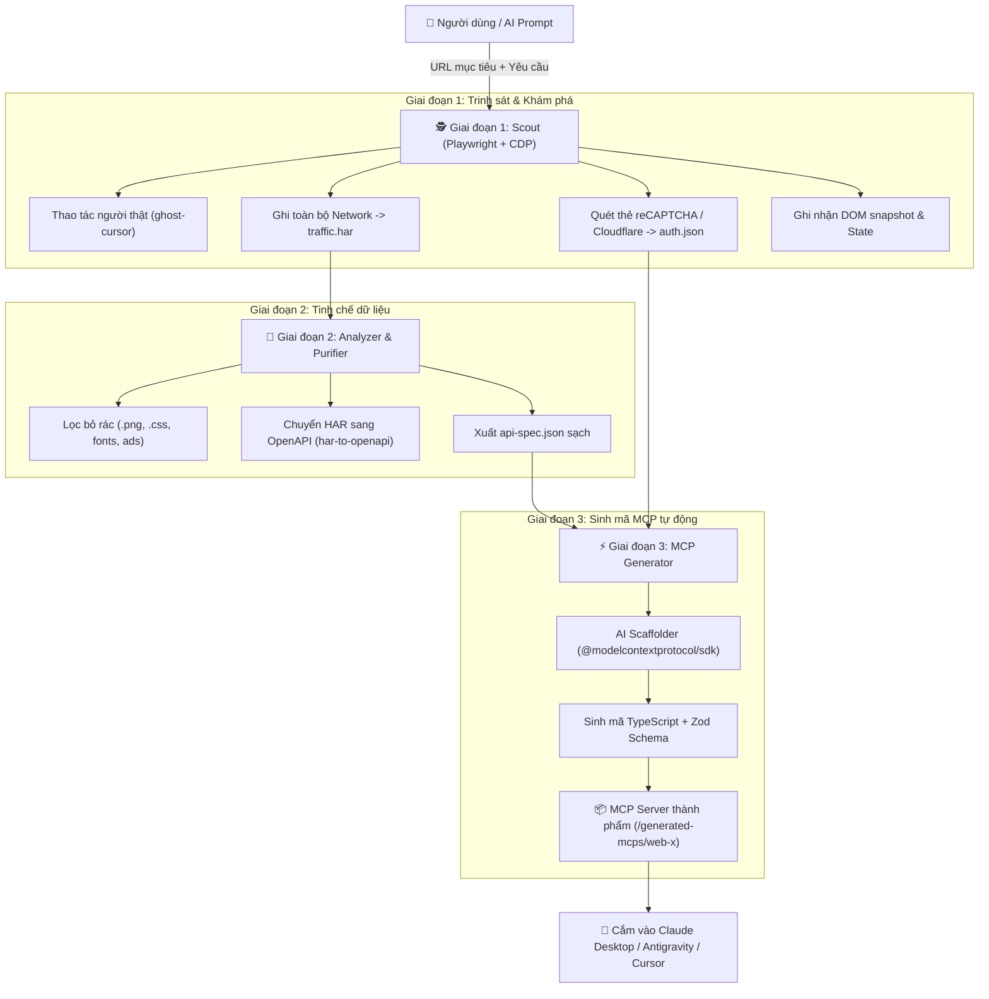

# Kế Hoạch Triển Khai Dự Án: Web-to-MCP Studio
> **Mục tiêu:** Xây dựng hệ thống tự động hóa cho AI: Điều khiển trình duyệt thám thính website mục tiêu (bắt trọn Network, DOM, JS Runtime, cơ chế reCAPTCHA) và tự động sinh ra một **MCP Server độc lập** chuyên biệt cho website đó.

---

## 1. Tổng quan Kiến trúc Hệ thống

Hệ thống vận hành theo đường ống 3 giai đoạn (3-Stage Pipeline):



---

## 2. Cấu trúc Dự án (Project Structure)

```text
web-to-mcp-studio/
├── .agents/
│   ├── rules/
│   │   ├── recon-safety.md           # Quy tắc: Tốc độ tương tác, delay ngẫu nhiên, bảo mật cookie
│   │   └── mcp-code-standards.md     # Chuẩn code MCP: TypeScript nghiêm ngặt, Zod validation, error-handling
│   └── skills/
│       ├── web-scout/SKILL.md        # Hướng dẫn AI cách lái browser, bắt token, trích xuất reCAPTCHA sitekey
│       ├── har-analyzer/SKILL.md     # Hướng dẫn AI cách lọc request rác, phân loại endpoints
│       └── mcp-scaffolder/SKILL.md   # Mẫu code MCP Server chuẩn để AI nhìn vào và sinh code
├── src/
│   ├── scout/                        # Bộ phận Trinh sát (Browser Automation)
│   │   ├── browser.ts                # Khởi tạo Playwright stealth, bật CDP & ghi HAR
│   │   ├── cursor.ts                 # Điều khiển chuột đường cong Bézier (ghost-cursor)
│   │   └── detector.ts               # Tự động phát hiện reCAPTCHA (v2/v3), Turnstile, CSRF tokens
│   ├── analyzer/                     # Bộ phận Tinh chế
│   │   ├── harFilter.ts              # Lọc request chỉ lấy XHR/Fetch & JSON
│   │   └── specGenerator.ts          # Chuyển đổi HAR đã lọc thành OpenAPI Spec (api-spec.json)
│   ├── generator/                    # Bộ phận Sinh mã MCP Server
│   │   ├── templates/
│   │   │   ├── package.json.hbs      # Template package.json cho MCP mới
│   │   │   ├── tsconfig.json.hbs     # Template TypeScript
│   │   │   └── index.ts.hbs          # Template mã nguồn MCP Server SDK
│   │   └── builder.ts                # Logic đọc OpenAPI + auth.json để compile ra thư mục MCP
│   └── cli/                          # Giao diện dòng lệnh tiện ích
│       └── index.ts                  # Lệnh: pnpm scout <url>, pnpm build-mcp <name>
├── generated-mcps/                   # Thư mục chứa các MCP Server thành phẩm
│   └── .gitkeep
├── package.json
├── tsconfig.json
└── README.md
```

---

## 3. Lộ trình Triển khai Chi tiết (Phased Execution Plan)

### Giai đoạn 1: Thiết lập nền tảng dự án & Hệ thống Agent Rules / Skills
*Thời gian dự kiến: 1 ngày*

- [ ] **Bước 1.1:** Khởi tạo repository Node.js + TypeScript (`pnpm init`, cấu hình `tsconfig.json`).
- [ ] **Bước 1.2:** Cài đặt các dependencies lõi:
  - `playwright`, `ghost-cursor-playwright`, `playwright-stealth`
  - `@modelcontextprotocol/sdk`, `zod`
  - `har-to-openapi`, `commander` (cho CLI)
- [ ] **Bước 1.3:** Xây dựng hệ thống tài liệu Agent:
  - Viết `.agents/rules/recon-safety.md`: Quy định thời gian chờ giữa các thao tác (300-800ms jitter), không spam request làm sập server mục tiêu.
  - Viết `.agents/rules/mcp-code-standards.md`: Quy chuẩn đặt tên tool, mô tả schema chi tiết, bắt buộc có try/catch.
  - Viết `.agents/skills/web-scout/SKILL.md`: Checklists khi vào 1 trang web (quét Network trước -> tìm form input -> đọc DOM -> tìm token).
  - Viết `.agents/skills/mcp-scaffolder/SKILL.md`: Cung cấp code mẫu SDK `@modelcontextprotocol/sdk`.

---

### Giai đoạn 2: Xây dựng Module Scout (Trinh sát & Ghi dữ liệu)
*Thời gian dự kiến: 2 ngày*

- [ ] **Bước 2.1:** Viết `src/scout/browser.ts`:
  - Khởi tạo Playwright Context với cờ `recordHar` đầy đủ (`mode: 'full'`, `content: 'attach'`).
  - Tích hợp cờ ẩn danh chống nhận diện bot (`--disable-blink-features=AutomationControlled`).
- [ ] **Bước 2.2:** Viết `src/scout/cursor.ts`:
  - Bọc `ghost-cursor-playwright` vào các hàm thao tác: `humanClick(selector)`, `humanType(selector, text, delay)`.
- [ ] **Bước 2.3:** Viết `src/scout/detector.ts` (Giải mã bảo mật & reCAPTCHA):
  - Tự động quét DOM tìm các thuộc tính: `[data-sitekey]`, iframe `google.com/recaptcha`, `window.grecaptcha`.
  - Bắt các trường token submit: `g-recaptcha-response`, `cf-turnstile-response`.
  - Trích xuất Cookie và LocalStorage lưu vào `auth-state.json`.

---

### Giai đoạn 3: Xây dựng Module Analyzer (Lọc HAR & Chuyển thành OpenAPI)
*Thời gian dự kiến: 1.5 ngày*

- [ ] **Bước 3.1:** Viết `src/analyzer/harFilter.ts`:
  - Đọc file `traffic.har` sinh ra từ Giai đoạn 2.
  - Bộ lọc loại trừ: Loại bỏ URL đuôi `.png`, `.jpg`, `.svg`, `.css`, `.woff2`, các domain quảng cáo (Google Analytics, Hotjar, Facebook Pixel).
  - Bộ lọc giữ lại: Các request có MIME type `application/json`, request có method `POST`/`PUT`/`DELETE`, hoặc URL chứa tiền tố `/api/`, `/v1/`, `/graphql`.
- [ ] **Bước 3.2:** Viết `src/analyzer/specGenerator.ts`:
  - Tích hợp thư viện `har-to-openapi` để chuyển đổi file HAR sạch thành đặc tả `api-spec.json`.
  - Tự động tổng hợp danh sách Header bắt buộc (ví dụ: `Authorization: Bearer ...`, `Cookie: ...`, `X-CSRF-Token`).

---

### Giai đoạn 4: Xây dựng Module Generator (Tự động sinh mã MCP Server)
*Thời gian dự kiến: 2 ngày*

- [ ] **Bước 4.1:** Thiết kế Template MCP Server (`src/generator/templates/index.ts.hbs`):
  - Cấu trúc Server chuẩn theo `@modelcontextprotocol/sdk`.
  - Logic tự động sinh schema `zod` cho từng tham số query / body của API.
  - Xử lý xác thực tự động (tự nhét cookie / auth token từ `auth-state.json` vào header).
- [ ] **Bước 4.2:** Viết `src/generator/builder.ts`:
  - Nhận đầu vào: `api-spec.json` + `auth-state.json`.
  - Sinh toàn bộ thư mục `generated-mcps/<tên-web>/`:
    - `package.json` độc lập.
    - `index.ts` chứa danh sách các Tool đã ánh xạ từ API.
    - `README.md` hướng dẫn cấu hình vào file `claude_desktop_config.json` hoặc Antigravity.
- [ ] **Bước 4.3:** Xử lý trường hợp có reCAPTCHA:
  - Nếu API đòi hỏi token reCAPTCHA: Tự động bổ sung tùy chọn tích hợp giải token (thông qua CapSolver/2Captcha API key hoặc mở 1 headless browser ngầm 3 giây để lấy token).

---

### Giai đoạn 5: Tích hợp CLI & Kiểm thử Toàn diện (E2E Test)
*Thời gian dự kiến: 1.5 ngày*

- [ ] **Bước 5.1:** Xây dựng lệnh CLI điều khiển (`src/cli/index.ts`):
  - `pnpm scout --url <link> --name <web-name>`: Mở trình duyệt trinh sát.
  - `pnpm analyze --name <web-name>`: Lọc dữ liệu và tạo đặc tả API.
  - `pnpm generate --name <web-name>`: Sinh mã MCP Server thành phẩm.
  - `pnpm auto --url <link> --name <web-name>`: Chạy trọn gói pipeline từ đầu đến cuối.
- [ ] **Bước 5.2:** Kiểm thử thực tế:
  - Test case 1: Website tin tức / blog có API công khai.
  - Test case 2: Website thương mại điện tử có tìm kiếm và phân trang (JSON payload).
  - Test case 3: Website có form đăng nhập / liên hệ được bảo vệ bởi reCAPTCHA.
- [ ] **Bước 5.3:** Kết nối thử nghiệm MCP Server vừa sinh ra vào Antigravity/Claude và gọi tool để xác nhận dữ liệu trả về chính xác 100%.

---

## 4. Bảng phân công Thư viện & Công nghệ

| Tác vụ | Thư viện / Công nghệ | Lý do lựa chọn |
| :--- | :--- | :--- |
| **Môi trường & Ngôn ngữ** | Node.js 20+, TypeScript, pnpm | Hiệu năng cao, type-safety tuyệt đối, đồng bộ hệ sinh thái |
| **Trình duyệt & CDP** | Playwright + `ghost-cursor-playwright` | Bắt HAR siêu chuẩn, chống phát hiện bot, di chuột như người thật |
| **Bóc tách API** | `har-to-openapi` | Chuẩn hóa toàn bộ request/response thành OpenAPI Spec phổ biến |
| **MCP SDK** | `@modelcontextprotocol/sdk` + `zod` | SDK chính thức từ Model Context Protocol, hỗ trợ validation mạnh mẽ |
| **Sinh mã nguồn (Templating)** | Handlebars (`hbs`) hoặc TS Code Builder | Sinh code sạch, chuẩn format, dễ bảo trì |
